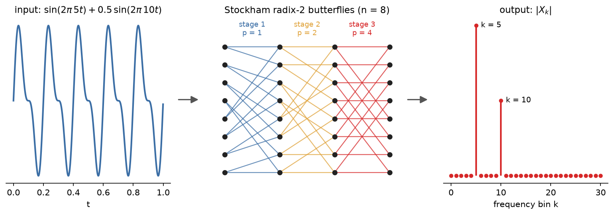
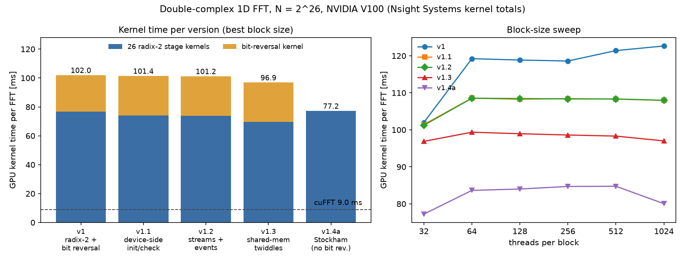
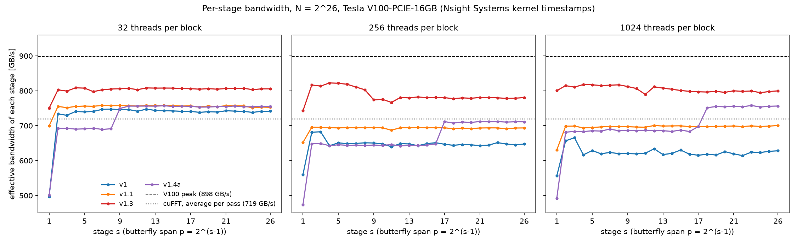

# CUDA Stockham FFT


<sub>The spectrum is computed with NumPy for N = 1024, and the middle panel is our Stockham kernel's data flow for n = 8.</sub>

In this repo we write a double-precision complex 1D FFT from scratch in CUDA. We then try to optimise it step by step on an NVIDIA V100 and check it against cuFFT at every step for correctness (and as a reference timing, but cuFFT smokes our attempts). Written for the *Advanced GPU Programming* course in the [Master in High Performance Computing (MHPC)](https://www.mhpc.it/) at SISSA/ICTP (February 2026).

## Repository layout
```
src/fft.cu                      final version (v1.4) with Stockham + precomputed twiddle table + shared-memory twiddle cache
versions/                       each benchmarked version as it was run
  v1_bitreverse.cu
  v1.1_device_init.cu
  v1.2_streams_events.cu
  v1.3_smem_twiddles.cu
  v1.4a_stockham.cu             Stockham with twiddles computed in the kernel
scripts/                        Slurm jobs for the COKA cluster (University of Ferrara)
results/summary.csv             kernel and wall times for every version and block size
results/kernel_launches.csv     every kernel launch (856) with its duration, stream and launch config
results/logs/                   program output, Nsight Systems --stats tables, and ptxas reports per job
results/plot_results.py         makes a summary figure!
results/plot_per_stage.py       makes the per-stage bandwidth figure
results/nsys_to_csv.py          pulls kernel_launches.csv out of the Nsight Systems .sqlite exports
results/plot_banner.py          makes the conceptual banner at the top of this README
```

`src/fft.cu` adds two more changes on top of v1.4a. (a) the twiddle factors are precomputed once into a lookup table with `sincos`, and (b) stages with few distinct twiddles cache them in shared memory. We don't have a benchmark for this final version :(

## How it works!
We generate a test signal $\sin{(2 \pi \times 5t)} + 0.5 \sin{(2 \pi \times 10t)}$ directly on the GPU. It runs cuFFT on one stream and my FFT on another, once for each block size from 32 to 1024 threads. It then computes the relative L2 error ‖X_cuFFT − X_mine‖ / ‖X_cuFFT‖ with a reduction kernel.

The Stockham kernel launches N/2 threads per stage, one butterfly each. At stage p (p = 1, 2, 4, …), thread `t` reads `x[t]` and `x[t + N/2]`, multiplies the second by the twiddle `w = exp(-2πi·j/2p)` with `j = t mod p`, and writes `x[t] ± w·x[t + N/2]` to positions `2t − j` and `2t − j + p` of the other buffer. Reads are contiguous in every stage, and the output ends up in natural order without a bit-reversal pass.

## Build and run
Requires the CUDA toolkit (with cuFFT) and an NVIDIA GPU.

```bash
make                         # builds ./fft for sm_70 (V100); use ARCH=sm_80 for A100, etc.
./fft 67108864               # N must be a power of two

make SRC=versions/v1.3_smem_twiddles.cu   # build an earlier version
```

On a Slurm cluster with Nsight Systems and Nsight Compute (adjust partition and module names):

```bash
cd scripts
sbatch v100.job                                   # final version
sbatch v100.job ../versions/v1_bitreverse.cu      # any other version
```

The V100 job runs the binary under `nsys profile --stats=true`, then under `ncu --set full`. The full Nsight Compute reports (40–55 MB each) are not included here.

## Results!


We ended up with $N = 2^{26}$ complex doubles (which is about 1 GiB per array) on a Tesla V100-PCIE-16GB (sm_70, CUDA 11.8). Kernel times are the totals Nsight Systems reports for one transform. Wall times are gained by using `cudaEvent` timings within the programme. We only list the best times for from the 32–1024 threads per block sweeps (32 ends up being the best every time).

| Version | Version details     | Kernel time | Wall time | Rel. L2 error vs cuFFT |
| --- | --- | ---: | ---: | ---: |
| v1 | Iterative radix-2 Cooley–Tukey with one bit-reversal kernel, then one kernel per stage | 102.0 ms | 102.3 ms | 1.27e-15 |
| v1.1 | Input generated on the device and the accuracy check moved to a GPU kernel | 101.4 ms | 101.8 ms | 1.27e-15 |
| v1.2 | Separate CUDA streams for cuFFT and my FFT joined by an event, `cudaEvent` timing, and no more `cudaDeviceSynchronize()` after every stage | 101.2 ms | 101.3 ms | 1.27e-15 |
| v1.3 | Per-block twiddle cache in shared memory, sized by an occupancy search. And we have block-level reduction in the accuracy check | 96.9 ms | 96.9 ms | 1.27e-15 |
| v1.4a | Stockham autosort formulation with ping-pong buffers and no bit-reversal pass | **77.2 ms** | **82.8 ms** | 1.27e-15 |
| cuFFT | `cufftExecZ2Z`with the same input | 9.0 ms | 9.0 ms | N/A |

Some observations!

- The wall time for v1.4a is a bit higher than kernel time because its timed region also allocates and frees the 1 GiB scratch buffer.
- Bit reversal was a quarter of the runtime! It took 25–33 ms in every version, and that's as long as nine or ten butterfly stages. Its scattered reads and writes reach only about 80 GB/s. The Stockham formulation gets rid of this entirely.
- For the validation kernel, in v1.1 every thread did a double-precision `atomicAdd` into one global value. In v1.3 each block reduces in shared memory first, then does one atomic per block. The kernel then goes from 155 ms to 2.4 ms.
- With `-Xptxas=-v`we have 32 registers for the v1 stage kernel, 34 for v1.3 and 38 for the Stockham kernel, all with no spills.
- 32 threads per block was fastest in every version. The v1 kernels were 16–20 % slower at 64 threads and above.
- On a K80 (sm_37), v1 took 493–609 ms against 57 ms for cuFFT.

### Stage by stage
Nsight Systems records every kernel launch, so we can time each of the 26 stages on its own. Each stage reads and writes the whole array once (about 2.15 GB), so we plot this as an effective bandwidth per stage:



More observations!

- Moving from our own `Complex` struct (v1) to `cuDoubleComplex` (v1.1) made every stage faster. 3 % at 32 threads per block, 7 % at 256 and 11 % at 1024. The struct is two doubles with 8-byte alignment, while `cuDoubleComplex` is a 16-byte aligned `double2`, so each element can be loaded in one 128-bit access instead of two 64-bit ones. So maybe it is an allignment issue.
 - Dropping `cudaDeviceSynchronize()` in v1.2 after every stage was very beneficial. With it, the GPU sat idle for a median 8.4 $\mu$s between stage kernels. Without it, kernels are queued back to back and the gaps drop to 0.9 $\mu$s. However that's still only 0.2–0.7 ms per FFT, so launch overhead was never the bottleneck.
- `cufftRun` waits on its stop event (`cudaEventSynchronize`) before returning, so the host only launches our FFT once cuFFT is done. Both FFTs are memory-bound, so overlapping them wouldn't have bought much anyway.
- v1.3's stages are the fastest of all our versions at about 800 GB/s (89 % of the 898 GB/s peak). The twiddle cache is at work at 256 and 1024 threads. Bandwidth dips at the stage where the butterfly span reaches the block size (stage 9 and stage 11), because from there on, every thread has to compute a twiddle to fill the cache anyway.

## Things I'd like to understand
- Once the span is larger than the block, most twiddles aren't cached, and the kernels do nearly the same work. But v1.3 still runs at about 780–805 GB/s against v1.1's 695–755 GB/s. Why is v1.3 still faster than v1.1 in the late stages?
- Why does v1.4a suddenly speed up? Bandwidth jumps by about 10 % at stage 9 with 32 threads per block, at stage 17 with 256 and at stage 18 with 1024. How does the bandwidth jump depend on block size is not obvious to me.
- Why is the first Stockham stage so slow? The first stage takes 40-50 % longer than the others at every block size. It's also the stage that writes into the scratch buffer straight after `cudaMalloc`, so maybe first-touch costs?

The full Nsight Compute reports from these runs have DRAM and L2 traffic, load widths, stall reasons for every stage kernel. They should answer all three questions.

## How do we match cuFFT?
Each radix-2 stage reads and writes the whole array once. That's $2 \times 2^{26} \times 16 \text{ B} \approx 2.15 \text{ GB}$ of memory traffic. The individual stages already run close to the V100's 898 GB/s, similar to cuFFT:

| Kernel | Time per pass | Effective bandwidth |
| --- | ---: | ---: |
| v1.3 butterfly stage (in place) | 2.67 ms | ≈ 800 GB/s |
| v1.4a Stockham stage (out of place) | 2.97 ms | ≈ 720 GB/s |
| cuFFT (3 kernels with radix 512 × 512 × 256) | 2.99 ms | ≈ 720 GB/s |

A radix-2 FFT of 2^26 points needs 26 passes over memory, which is at least $26 \times 2.15 \text{ GB} / 898 \text{ GB/s} \approx 62 \text{ ms}$. cuFFT does the same transform in 3 passes. The next step is to do several stages per kernel in shared memory or registers, so that the data is read from global memory fewer times.

## COKA
We ran on COKA which is a GPU cluster run by INFN and the University of Ferrara. It started life in the INFN project *Computing on Knights and Kepler Architectures*, which tested Xeon Phi and NVIDIA GPU boards for physics codes. Its original nodes each had two Intel Xeon E5-2630 v3 CPUs and eight dual-GPU K80 boards, linked by 56 Gb/s FDR InfiniBand ([Bonati et al. 2018](https://arxiv.org/abs/1801.01473)). Newer Volta and Pascal GPUs were added after, and the course gave us all three generations to play with.

Our V100 runs landed on `node06` in the `skyvolta` partition: two Intel Xeon Gold 6130 CPUs (2 × 16 cores at 2.1 GHz), two Tesla V100-PCIE-16GB and one Tesla P100-PCIE-16GB, running CentOS 7 with NVIDIA driver 470.57 (CUDA 11.4) and the CUDA 11.8 toolkit. The K80 runs went to the `longrun` partition.

| GPU | Architecture (compute capability) | SMs | Max clock | Memory | Memory bandwidth | L2 cache |
| --- | --- | ---: | ---: | --- | ---: | ---: |
| Tesla K80 (one of the board's two GK210 GPUs) | Kepler (3.7) | 13 | 824 MHz | 11.2 GiB GDDR5, 384-bit | ≈ 240 GB/s | 1.5 MB |
| Tesla P100-PCIE-16GB | Pascal (6.0) | 56 | 1329 MHz | 16 GB HBM2 | 732 GB/s | 4 MB |
| Tesla V100-PCIE-16GB | Volta (7.0) | 80 | 1380 MHz | 16 GB HBM2, 4096-bit | 898 GB/s | 6 MB |

